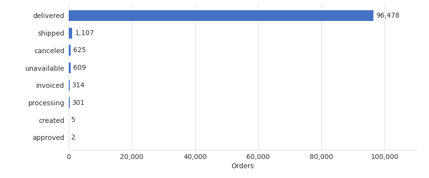
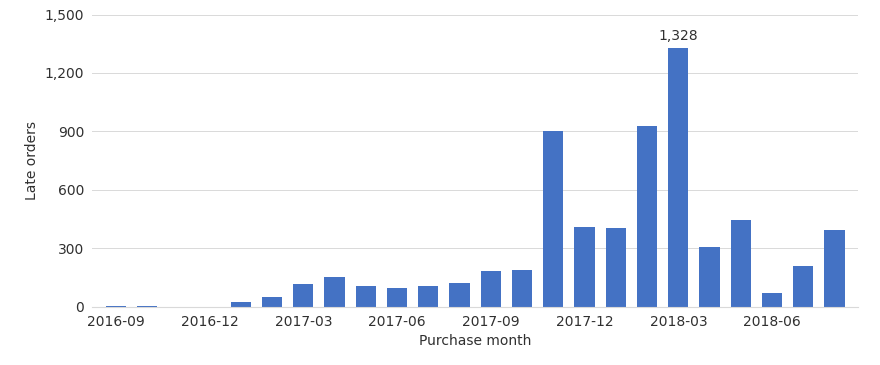

# Olist Delivery Analysis

An SQL practice project exploring delivery performance in the Brazilian E-Commerce Public Dataset by Olist. The main question is how often orders arrive after the estimated delivery date.

## Setup

1. Download the [Olist dataset from Kaggle](https://www.kaggle.com/datasets/olistbr/brazilian-ecommerce) and extract the CSV files into `data/raw/`.
2. Open a PostgreSQL connection in DBeaver and run [sql/setup.sql](sql/setup.sql) to create the `raw.orders` table.
3. In DBeaver, right-click `raw.orders` and choose **Import Data**. Select `data/raw/olist_orders_dataset.csv`, use the first row as column names, and map the columns by name. Import into an empty table to avoid duplicate order IDs.

Each row in `raw.orders` represents one order. The raw CSV files are kept locally and ignored by Git.

## Order Status and Delivery Performance

### Q01. Order Status Breakdown

**Question:** How many orders are in each status?

**Answer:** Delivered: 96,478; shipped: 1,107; canceled: 625; unavailable: 609;
invoiced: 314; processing: 301; created: 5; approved: 2.

### Q02. Missing Delivery Dates

**Question:** How many orders marked as delivered are missing the actual or estimated delivery date?

**Answer:** Eight orders were missing a delivery date. In all eight cases, the actual delivery date was missing.

### Q03. Average Delivery Time

**Question:** How many calendar days passed on average between purchase and delivery?

**Answer:** Delivery took an average of 12.50 calendar days across 96,470 orders with a recorded delivery date.

### Q04. Total Late Deliveries

**Question:** How many delivered orders arrived after their estimated delivery date?

**Answer:** 6,534 orders arrived after their estimated delivery date.

### Q05. Late Deliveries by Purchase Month

**Question:** Which purchase months had the most late deliveries?

**Answer:** March 2018 had the most late deliveries (1,328), followed by February 2018 (926) and November 2017 (904).

